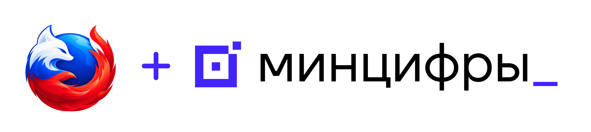

# Цифролис

Firefox для Android со встроенными сертификатами Минцифры. Неофициальная сборка.

## Преимущества

- **Готов к работе** — сертификаты уже встроены.
- **Без изменений в Android** — системное хранилище сертификатов не затрагивается.
- **Рядом с Firefox** — устанавливается как отдельное приложение.

## Сертификаты Минцифры

Сертификаты получены по ссылкам со [страницы Госуслуг](https://www.gosuslugi.ru/landing/crt_linux):

- [Russian_Trusted_Root_CA.cer](https://gu-st.ru/content/downloads/Russian_Trusted_Root_CA.cer) — корневой сертификат.
- [Russian_Trusted_Sub_CA.cer](https://gu-st.ru/content/downloads/Russian_Trusted_Sub_CA.cer) — промежуточный сертификат.
- [Russian_Trusted_Sub_CA_2024.cer](https://gu-st.ru/content/downloads/Russian_Trusted_Sub_CA_2024.cer) — промежуточный сертификат 2024 года.

SHA-256 файлов, скачанных по указанным ссылкам 28 октября 2026 года:

```text
936a43fea6e8e525bcc0f81acd9c3d21b4fc4b9b68acea7906d698005afc6504  Russian_Trusted_Root_CA.cer
f0ae589f36774f29ef3648f7984b08d42fcce6f1ffeeb6236d773daeb2744ea6  Russian_Trusted_Sub_CA.cer
6f9d829c8e6712444fce3624658d8788672849c5d5b7b53fd9cf7e83eac4193e  Russian_Trusted_Sub_CA_2024.cer
```

Сертификаты используются только внутри приложения и не добавляются в системное хранилище Android.

## FAQ

**Зачем нужны сертификаты Минцифры?**  
Чтобы браузер мог устанавливать защищённое соединение с сайтами, использующими эти сертификаты (банки, государственные сервисы, платёжные системы), без ошибок доверия.

**Нужно устанавливать сертификаты вручную?**  
Нет, они уже включены в браузер.

**Как проверить поддержку сертификатов?**  
Откройте в Цифролисе [страницу проверки Сбербанка](https://www.sberbank.ru/ru/certificates). Она сразу покажет, поддерживает ли браузер сертификаты Минцифры.

**Сертификаты появятся в других приложениях?**  
Нет, встроенные сертификаты действуют только внутри Цифролиса.

**Это официальный Firefox?**  
Нет, это независимая сборка на его основе.

## Скачать

[Скачать APK](https://github.com/okedokii/cifrolis/releases)

**Через F-Droid:** добавьте [неофициальный репозиторий Цифролиса](https://okedokii.github.io/cifrolis/fdroid/repo/), чтобы установить браузер и получать обновления.

## Автоматическая сборка

GitHub Actions дважды в сутки проверяет стабильный канал **Firefox для Android** по Mozilla Product Details (с официальным зеркалом на GitHub при ошибке). Новая версия собирается из официального Android release-тега; уже собранные версии пропускаются. Мажорные и минорные обновления проходят одинаковые проверки. При изменении исходников или сборочных требований пайплайн останавливается, а не пропускает несовместимые патчи.

На 26.11.2026 рецепт актуализирован для Firefox 161.0: Rust 1.95.0, современный механизм Rust ThinLTO, отдельный манифест без Mozilla shared UID и sharedUserMaxSdkVersion. Clang/WASI остаются закреплёнными по контрольным суммам. Полная совместимость подтверждается только успешной сборкой и проверкой подписанного APK.

После успешной автоматической сборки подписанный APK и SHA-256 публикуются в GitHub Releases, затем запускается обновление подписанного индекса собственного F-Droid-репозитория. Для ручного запуска опубликованного релиза используется workflow «Цифролис» с publish=true либо изменение ci/release-build-request.json в main. Старые релизы и ключ подписи сохраняются.
